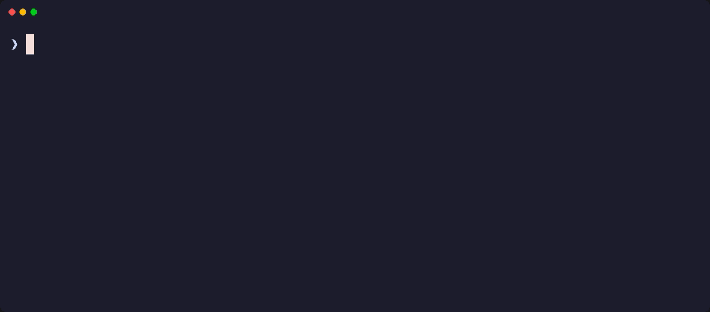
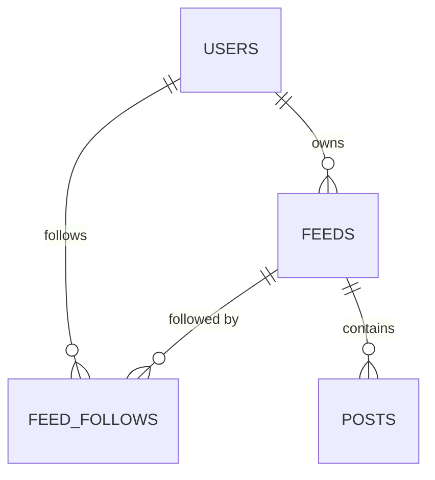

# Gator

[](https://go.dev/)
[](https://www.postgresql.org/)
[](LICENSE)

A terminal-based RSS feed aggregator written in Go. Gator lets multiple users add RSS feeds, follow feeds shared by others, collect posts into PostgreSQL, and browse the latest articles from the command line.



## Features

- Multiple local users, each with their own followed feeds
- Add RSS feeds and automatically follow them
- Follow or unfollow feeds added by other users
- Long-running aggregator that fetches the least recently updated feed on a timer
- Posts stored in PostgreSQL and deduplicated by URL
- Browse posts from the feeds you follow, newest first
- Single binary; only PostgreSQL is required at runtime

## Tech Stack

Go · PostgreSQL · sqlc · Goose · lib/pq · google/uuid

## Quick Start

Gator requires Go 1.27.3+ and PostgreSQL 14+. See [docs/SETUP.md](docs/SETUP.md) for platform-specific installation, database setup, and configuration.

```bash
git clone https://github.com/3mmarx/gator.git
cd gator

createdb gator
# Create ~/.gatorconfig.json with your PostgreSQL connection string.
# See docs/SETUP.md for the format and examples.

go install github.com/pressly/goose/v3/cmd/goose@latest
export PATH="$(go env GOPATH)/bin:$PATH"

goose -dir sql/schema postgres \
  "postgres://$(whoami)@localhost:5432/gator?sslmode=disable" up

go run . register ammar
go run . addfeed "Hacker News" "https://news.ycombinator.com/rss"
go run . following
```

Start the aggregator in one terminal:

```bash
go run . agg 1m
```

Browse the latest posts in another:

```bash
go run . browse 10
```

These examples use `go run .` because they assume you are in a clone of the repository. If you installed the binary, replace `go run .` with `gator`.

## Commands

| Command | Description | Requires login |
| --- | --- | --- |
| `gator register <username>` | Create a new user and set them as the current user | No |
| `gator login <username>` | Switch to an existing user | No |
| `gator users` | List all registered users; the current user is marked with `*` | No |
| `gator reset` | Delete all users and, by cascade, their feeds, follows, and posts | No |
| `gator feeds` | List every feed with its name, URL, and owner | No |
| `gator addfeed <name> <url>` | Add a feed and automatically follow it | Yes |
| `gator follow <url>` | Follow a feed that already exists | Yes |
| `gator following` | List the feeds followed by the current user | Yes |
| `gator unfollow <url>` | Unfollow a feed | Yes |
| `gator agg <duration>` | Continuously fetch the least recently fetched feed every `<duration>` | No |
| `gator browse [limit]` | Show recent posts from followed feeds; defaults to 2 | Yes |

Durations use Go syntax, for example `30s`, `1m`, or `1h`. The `agg` command fetches feeds across all users, not just the current user.

## How It Works

1. On startup, `main.go` reads `~/.gatorconfig.json`, opens a PostgreSQL connection, and registers every command in a handler map.
2. Commands that need a user are wrapped in `middlewareLoggedIn`, which loads the user named by `current_user_name`.
3. `gator agg` selects the feed with the oldest `last_fetched_at` (or one that has never been fetched), marks it as fetched, downloads its RSS XML, and inserts each item as a post.
4. Post URLs are unique, so running the aggregator repeatedly does not create duplicates.
5. `gator browse` joins `posts` with `feed_follows` for the current user and returns the newest posts first.

## Database Schema



- `users` — registered accounts with unique names
- `feeds` — RSS feeds, each owned by a user, with a nullable `last_fetched_at`
- `feed_follows` — many-to-many follows between users and feeds
- `posts` — fetched articles with a unique URL for deduplication

The full schema lives in [`sql/schema`](sql/schema), and the queries used to generate the Go database layer live in [`sql/queries`](sql/queries).

## Project Structure

```text
.
├── main.go                  # Entry point and command registration
├── commands.go              # Command type, registry, and dispatch
├── middleware_loggedin.go   # Resolves the current user for protected commands
├── rss_feed.go              # HTTP fetching and RSS/XML parsing
├── handler_*.go             # One handler per CLI command
├── internal/
│   ├── config/              # ~/.gatorconfig.json handling
│   └── database/            # sqlc-generated database code
├── sql/
│   ├── schema/              # Goose migrations
│   └── queries/             # SQL queries used by sqlc
├── docs/
│   ├── SETUP.md             # Detailed setup and troubleshooting
│   ├── demo.gif             # Terminal showcase used by this README
│   └── demo.tape            # VHS script for the GIF
├── sqlc.yaml
├── go.mod
└── go.sum
```

## Development

Build the binary:

```bash
go build -o gator .
./gator browse 10
```

`go run .` is useful while developing. It compiles and runs the program on every invocation.

Regenerate the database layer after changing files in `sql/queries` or `sql/schema`:

```bash
go install github.com/sqlc-dev/sqlc/cmd/sqlc@latest
sqlc generate
```

Run the basic checks:

```bash
go build ./...
go vet ./...
```

## Troubleshooting

| Problem | Fix |
| --- | --- |
| `could not read config file` | Create `~/.gatorconfig.json` as described in [docs/SETUP.md](docs/SETUP.md#configuration). |
| `connect: connection refused` | Start PostgreSQL, for example `brew services start postgresql@18` or `sudo service postgresql start`. |
| `pq: database "gator" does not exist` | Run `createdb gator`. |
| `pq: relation "users" does not exist` | Apply the migrations with Goose. |
| `zsh: command not found: gator` | Add `$(go env GOPATH)/bin` to your `PATH`. |

More problems and fixes are covered in [docs/SETUP.md](docs/SETUP.md#troubleshooting).

## Acknowledgements

Gator was built as part of the [Build a Blog Aggregator in Go](https://www.boot.dev/courses/build-blog-aggregator-golang) course on [Boot.dev](https://www.boot.dev/).

## License

This project is licensed under the MIT License. See [LICENSE](LICENSE) for details.
